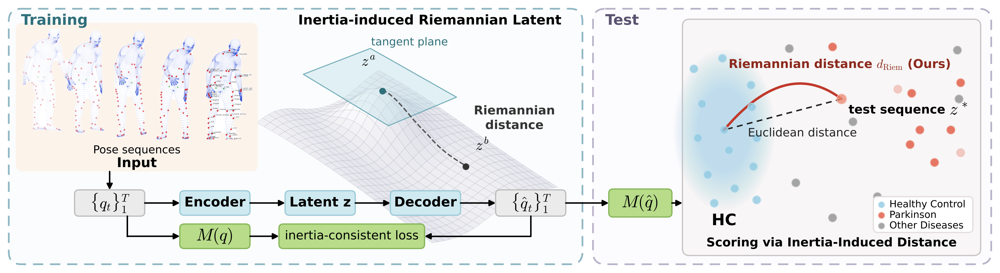
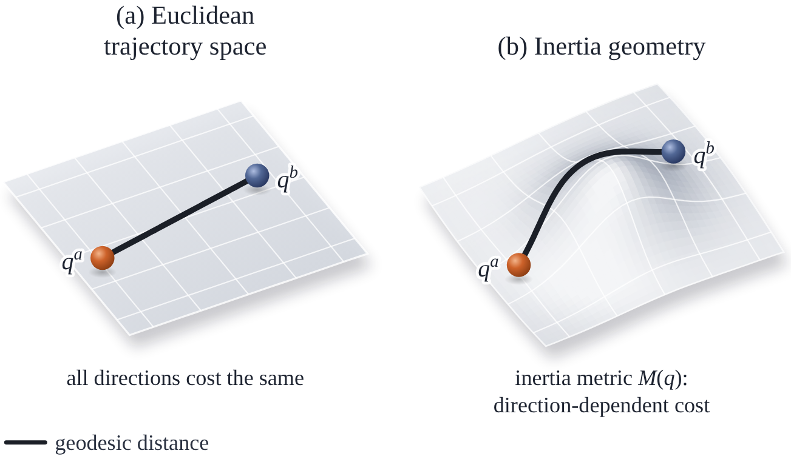

<div align="center">

# REINS: Learning Inertia-Induced Geometry for Physics-Consistent Motion Representation in Clinical Gait Phenotyping

**NeurIPS 2026 (poster)**

[Yiran Ding]<sup>1</sup>, [Yufei Zhang]<sup>2</sup>, Zijun Cui<sup>1</sup>

<sup>1</sup>[Michigan State University] &nbsp; <sup>2</sup>[Independent Researcher]

<!--[](https://openreview.net/forum?id=[ID]) [! -->[License: MIT](https://img.shields.io/badge/License-MIT-blue?style=for-the-badge)(LICENSE)



<sub><b>Fig. 1.</b> Overview of REINS. Training (left): a pose sequence is encoded into a latent vector and reconstructed by the decoder. The inertia-consistent loss weights the reconstruction velocity error by the body's inertia matrix <i>M</i>(<i>q</i>), so that the latent space inherits the inertia-induced geometry (surface). Distances between embedded sequences <i>z</i><sup>a</sup> and <i>z</i><sup>b</sup> are measured by the Riemannian distance under this geometry. Testing (right): a test sequence is embedded as <i>z</i><sup>*</sup>. The inertia matrix <i>M</i>(<i>q&#770;</i>) of its decoded pose defines the local metric, and the sequence is scored by its Riemannian distance <i>d</i><sub>Riem</sub> to the healthy-control (HC) reference embeddings. The score separates subjects with Parkinson's disease from healthy controls and correlates with clinical severity on cohorts not used for training. The Riemannian distance (ours) separates these groups more reliably than Euclidean distance (dashed).</sub>




<sub><b>Fig. 2.</b> Euclidean versus inertia-induced motion geometry. Two pose sequences, <i>q</i><sup>a</sup> and <i>q</i><sup>b</sup>, are marked in both panels, and the solid curve is the shortest path between them under the metric used in that panel. (a) Euclidean trajectory space treats all directions of motion equally and ignores the articulated mass distribution. (b) The inertia matrix <i>M</i>(<i>q</i>) assigns direction-dependent costs to motion, so both the shortest path between the two sequences and its length change, and the length measures the mechanical effort of transforming one sequence into the other.</sub>

</div>

This is the official PyTorch implementation of the paper [REINS: Riemannian Embedding for INertia-induced Motion Spaces](https://openreview.net/forum?id=[ID]) (NeurIPS 2026).

REINS is a motion representation for clinical gait assessment. We fine-tune [PhysPT](https://github.com/zhangy76/PhysPT) with an inertia-consistent loss $\mathcal{L}_{\text{ine}}$. For each test window, we measure the Riemannian distance from its embedding to the nearest healthy-control reference embedding. We compute this distance using the pullback metric $g(z) = J(z)^\top M(\hat q) J(z)$, where $J$ is the decoder Jacobian and $M(\hat q)$ is the generalized inertia matrix at the decoded poses. On [CARE-PD](https://github.com/TaatiTeam/CARE-PD), we use the scores to distinguish subjects with Parkinson's disease from healthy controls and compare the scores with clinical severity ratings.

The repository includes code for fine-tuning with the REINS objective and scoring with the pointwise metric, along with the subject list for the main split and the environment file. This setup reproduces the REINS row of Table 1 on the main split. We will add the code for the Euclidean baselines, external encoders, ablations, random splits, bootstrap intervals, and zero-shot evaluation after publication.

## Data and pretrained assets

These three assets are distributed by their authors under their own licenses and are not redistributed here.

- **CARE-PD** ([terms of use](https://neurips2025.care-pd.ca/terms-of-use.html), CC BY-NC 4.0). Download the dataset from Hugging Face. REINS uses the [DNE / canonicalized SMPL] cohort file.

  ```bash
  pip install -U huggingface_hub
  huggingface-cli download vida-adl/CARE-PD --repo-type dataset --local-dir CARE-PD
  ```

- **SMPL body model**. Register at the [SMPL-X website](https://smpl-x.is.tue.mpg.de/) and download the SMPL neutral model. PhysPT expects it at `assets/data/smpl/neutral.pkl`.
- **PhysPT checkpoint** (MIT). Download the pretrained assets from the link in the [PhysPT README](https://github.com/zhangy76/PhysPT#model-and-data-download) and place the checkpoint at `[assets/checkpoint/...]`.

## Installation

The paper runs used Python [3.7] and PyTorch [1.13.1+cu117].

```bash
git clone https://github.com/DominoAI-Lab/REINS-NeurIPS-2026.git
cd REINS-NeurIPS-2026
conda env create -f env.yml
conda activate reins
```

## Fine-tuning

```bash
python train.py --config configs/reins.yaml --data [path/to/DNE.pkl] --split split.csv --out out/reins
```

`configs/reins.yaml` holds the hyperparameters of the paper run. `split.csv` lists the healthy-control subjects used for fine-tuning (K = 20) and the held-out subjects of the main split. The held-out PD and other-disease subjects are never seen during fine-tuning.

## Scoring

```bash
python score.py --ckpt out/reins/[ckpt].pt --data [path/to/DNE.pkl] --split split.csv --knn_metric pointwise --out out/reins/scores
```

The script encodes the training windows to build the reference set and evaluates $M(\hat q_i)$ for each window. It uses the pointwise metric to weight the edges of the $\kappa$-nearest-neighbor graph and reports subject-level AUROC.


Report errors and questions on the [GitHub issues page](https://github.com/DominoAI-Lab/REINS-NeurIPS-2026/issues).

## License

- Code in this repository is released under the [MIT license](LICENSE). It builds on [PhysPT](https://github.com/zhangy76/PhysPT) (MIT, Zhang et al., CVPR 2024), whose copyright notice is retained.
- CARE-PD is released by its authors under [CC BY-NC 4.0](https://creativecommons.org/licenses/by-nc/4.0/) and its [terms of use](https://neurips2025.care-pd.ca/terms-of-use.html). It is not redistributed here. Do not attempt to re-identify the subjects.
- The SMPL body model is subject to the [SMPL license](https://smpl-x.is.tue.mpg.de/).
- REINS is a research method and is not intended for clinical decisions.

## Citation

```bibtex
@inproceedings{[key]2026reins,
  title     = {REINS: Learning Inertia-Induced Geometry for Physics-Consistent Motion Representation in Clinical Gait Phenotyping},
  author    = {[Ding, Yiran and Zhang, Yufei and Cui, Zijun]},
  booktitle = {Advances in Neural Information Processing Systems (NeurIPS)},
  year      = {2026}
}
```

Please also cite PhysPT and CARE-PD.

```bibtex
@INPROCEEDINGS{10657173,
  author={Zhang, Yufei and Kephart, Jeffrey O. and Cui, Zijun and Ji, Qiang},
  booktitle={2024 IEEE/CVF Conference on Computer Vision and Pattern Recognition (CVPR)}, 
  title={PhysPT: Physics-aware Pretrained Transformer for Estimating Human Dynamics from Monocular Videos}, 
  year={2024},
  volume={},
  number={},
  pages={2305-2317},
  keywords={Training;Accuracy;Three-dimensional displays;Force;Dynamics;Self-supervised learning;Transformers},
  doi={10.1109/CVPR52733.2024.00224}}

@inproceedings{NEURIPS2025_bedc7397,
 author = {Adeli, Vida and Klabu\v{c}ar, Ivan and Rajabi, Javad and Filtjens, Benjamin and Mehraban, Soroush and Wang, Diwei and Hoang, Trung Hieu and Do, Minh and Seo, Hyewon and MULLER, Candice and Coelho, Daniel and de Oliveira, Claudia and Ginis, Pieter and Gilat, Moran and Nieuwboer, Alice and Spildooren, Joke and Mckay, J. and Kwon, Hyeokhyen and Clifford, Gari and Esper, Christine and Factor, Stewart and Genias, Imari and Dadashzadeh, Amirhossein and Shum, Leia and Whone, Alan and Mirmehdi, Majid and Iaboni, Andrea and Taati, Babak},
 booktitle = {Advances in Neural Information Processing Systems},
 doi = {10.52202/085713-4391},
 editor = {D. Belgrave and C. Zhang and H. Lin and R. Pascanu and P. Koniusz and M. Ghassemi and N. Chen},
 pages = {},
 publisher = {Curran Associates, Inc.},
 title = {Care-PD: A Multi-Site Anonymized Clinical Dataset for Parkinson’s Disease Gait Assessment},
 url = {https://proceedings.neurips.cc/paper_files/paper/2025/file/bedc73979a95be7727af0c9a99c675ce-Paper-Datasets_and_Benchmarks_Track.pdf},
 volume = {38, Main Conference},
 year = {2025}
}
```

## Acknowledgments

REINS builds on [PhysPT](https://github.com/zhangy76/PhysPT) and the [CARE-PD](https://github.com/TaatiTeam/CARE-PD) benchmark. 
This work was supported by Michigan State University.

